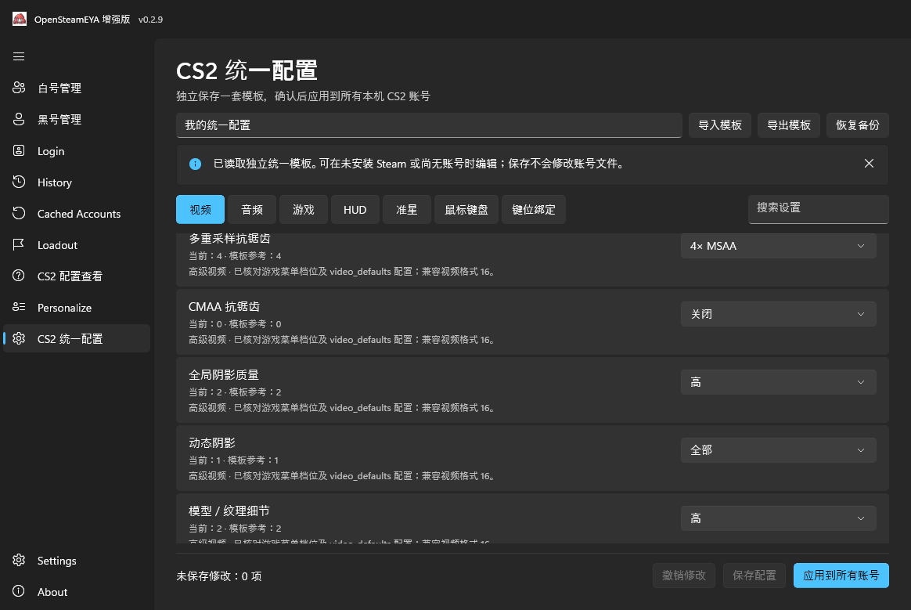

# OpenSteamEYA Enhanced

**Steam 多账号管理 · CS2 状态查询 · 统一游戏配置**

**[下载最新版 ↗](https://github.com/dbdbvdbdb/OpenSteamEYA-Enhanced/releases/latest) · [更新记录 ↗](CHANGELOG.md)**

白号管理 · v0.2.5-beta 真实 WinUI 测试截图，使用虚构数据；不是 v0.2.9 新截图。

| 👥 **账号管理** | 🎮 **CS2 状态查询** |
| --- | --- |
| 分类、搜索、分组、备注、收藏与批量操作。 | 查看优先分、等级、冷却及支持的状态信息。 |
| 🎛️ **统一配置** | 🗂️ **导入与备份** |
| 编辑一套模板，确认后应用到多个适用的本机账号。 | 批量添加，支持 TXT / CSV / JSON 导入导出及管理数据备份。 |

OpenSteamEYA Enhanced 是一款 Windows 平台的 Steam 账号管理工具。白号 / 黑号按添加来源分别管理，支持手动转移；分类名称不代表封禁状态。

保留 Steam/EYA 登录、历史与缓存账号、配装、个性化和创意工坊清理等功能。登录与联网查询需要可用的原登录凭据；单独保存账号密码不会生成 EYA 凭据。

[English](README_EN.md) · [详细使用指南](docs/RUNNING.zh-CN.md)

## 界面预览

**黑号管理**：按来源整理账号，支持搜索、筛选和批量操作。

*v0.2.5-beta 真实 WinUI 测试截图，使用虚构数据。*

**CS2 统一配置**：保存模板与应用到账号分开操作，应用前预览并备份。

*v0.2.9 真实 WinUI CI 截图，使用隔离模板；界面展示不代表游戏效果已逐项验收。*

[查看更多截图与来源](docs/screenshots/README.md)

## 快速开始

1. 从本仓库 [Releases](https://github.com/dbdbvdbdb/OpenSteamEYA-Enhanced/releases/latest) 下载 Windows x64 ZIP 或 7z。
2. **完整解压**到本地文件夹，保留全部运行文件和许可证，不能只提取 EXE。
3. 运行 `SteamEyaWinUI.exe`。

系统要求：Windows 10 1809（build 17763）及以上 x64；登录与读取本机账号配置需要安装 Steam。便携包无需额外安装 .NET Runtime。

升级前先通过管理工具备份数据，再将新版本解压到新文件夹。管理数据 ZIP 备份不包含原 EYA Token、Steam 会话或快速登录缓存，不能完整迁移登录状态。详见[备份与恢复](docs/FORMATS-AND-BACKUP.zh-CN.md)。

## 安全与使用提醒

- 本项目不是 Valve / Steam 官方软件，与上游开发者也没有官方合作或背书关系。
- **管理密码以明文保存**，导出和备份也可能包含账号密码。隐私模式和密码圆点只遮挡界面，不加密文件。
- 不要公开上传真实数据库、Token、备份或含凭据的截图；复制密码后不会自动清空剪贴板。
- CS2 统一配置应用的是**本地设置，不自动推送 Steam Cloud**；云端或其他配置可能覆盖本地结果。应用前关闭 CS2。
- 部分 CS2 设置受客户端、显示器或驱动限制，实际效果仍需游戏内确认；文件写入成功不等于效果已生效。

[完整安全说明](SECURITY.md) · [CS2 统一配置用法与限制](docs/CS2-UNIFIED-CONFIG.zh-CN.md) · [使用条款](END_USER_TERMS.txt)

## 最近更新

**v0.2.9**：新增独立 CS2 配置模板，支持导入、导出、备份恢复及确认后批量应用；保存模板不再直接修改账号配置，也不自动推送云端。

[查看完整更新记录](CHANGELOG.md) · [v0.2.9 发布说明](https://github.com/dbdbvdbdb/OpenSteamEYA-Enhanced/releases/tag/v0.2.9)

## 开源协议与致谢

基于 [OpenSteamEYA](https://github.com/hvh-software/OpenSteamEYA)，保留原作者 tuntun1337 的版权声明。感谢 [SteamAccountManager](https://github.com/Sakiora/SteamAccountManager) 的交互参考，以及 Microsoft 和其他依赖维护者；未复制该参考项目的代码或图像。

项目代码采用 [MIT](LICENSE)。Valve 资源、原品牌图像和 Microsoft 运行组件适用各自条款，MIT 不覆盖这些内容，详见[第三方声明](THIRD_PARTY_NOTICES.md)及随包许可证。如有版权问题，请通过本仓库联系维护者。

[反馈问题](https://github.com/dbdbvdbdb/OpenSteamEYA-Enhanced/issues) · [贡献指南](CONTRIBUTING.md)

开发者文档

- [源码编译、测试与下载校验](docs/BUILDING.zh-CN.md)
- [数据格式与备份边界](docs/FORMATS-AND-BACKUP.zh-CN.md)
- [启动检查更新说明](docs/UPDATES.zh-CN.md)
- [整理前的技术更新记录](docs/archive/CHANGELOG-technical.zh-CN.md)

