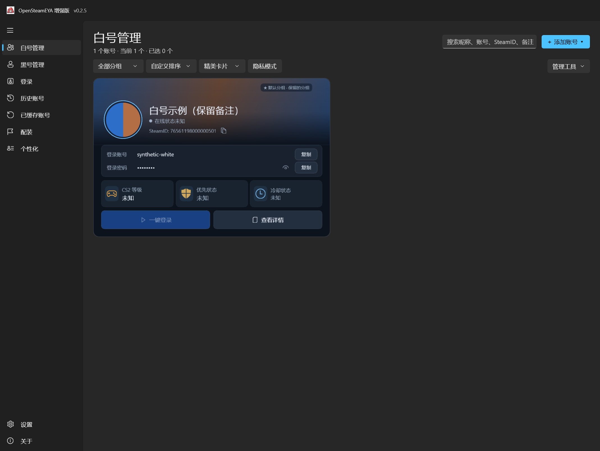
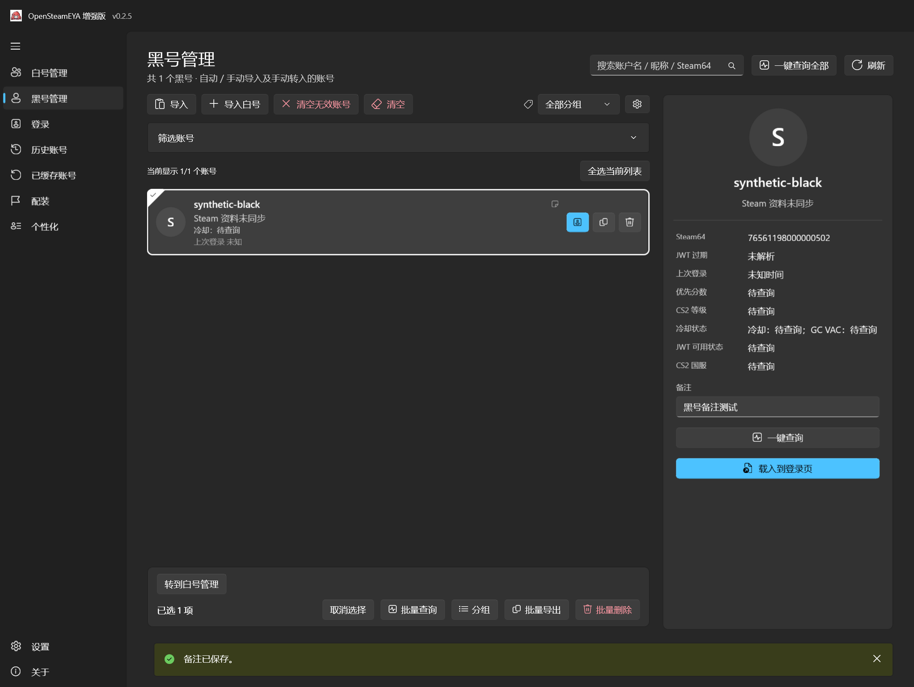

# OpenSteamEYA Enhanced

C# / WinUI 3 / .NET 10 的 Windows x64 Steam 账号工具，基于 [OpenSteamEYA](https://github.com/hvh-software/OpenSteamEYA) 扩展独立账号管理。当前版本为 **v0.2.5-beta（白号／黑号管理）**。

源码仓库：[dbdbvdbdb/OpenSteamEYA-Enhanced](https://github.com/dbdbvdbdb/OpenSteamEYA-Enhanced)。下载见 [v0.2.5-beta Release](https://github.com/dbdbvdbdb/OpenSteamEYA-Enhanced/releases/tag/v0.2.5-beta)；本次发布说明见 [v0.2.5-beta](docs/releases/v0.2.5-beta.md)，历史开源审查见 [发布审查报告](docs/RELEASE-AUDIT.zh-CN.md)。

详细规则与本地验证见 [v0.2.5 改造交付报告](docs/FEATURES-0.2.5.zh-CN.md)。

## 主要功能

- 保留 Steam/EYA 登录、历史及缓存账号、CS2 查询、配装、个性化、工坊和云同步。
- 账号卡片、紧凑列表、隐私模式、搜索、收藏、多分组、备注和三种背景；默认分组包含全部账号。
- 按 `steam账号----steam密码` 逐行批量添加；支持 TXT/CSV/JSON 导入导出和 ZIP 备份恢复。
- 多选查询 CS2：失败加入“失败”，无凭据加入“未查询”，成功后移除结果标记。
- 冷却时间用黄色、GCVAC 标记用红色，仅显示实际异常；无异常显示“正常”，无可靠数据显示“未知”。

按 SteamID/登录账号匹配历史及缓存账号，昵称不作为身份依据。账密登录勾选“同时添加到白号管理”后，成功保存历史时同步账号和本次密码；默认勾选并记忆。自动／手动及账号 Token 导入进入黑号管理，跨分类重复需人工选择唯一归属。旧管理记录留在白号管理，支持手动转移。单独添加账密不会生成 EYA 凭据。见 [使用指南](docs/RUNNING.zh-CN.md) 和 [更新记录](CHANGELOG.md)。

## 真实软件截图

以下为真实 WinUI 应用隔离测试截图，账号、密码与状态均为虚构测试数据，不代表真实 Steam 账号。截图不是 AI 效果图。





截图导出缩放不能代替各系统 DPI 的实机验收，见 [验收记录](docs/FEATURES-0.2.5.zh-CN.md)。

## Windows x64 下载与运行

Windows x64 Native AOT 便携包已在 [v0.2.5-beta Release](https://github.com/dbdbvdbdb/OpenSteamEYA-Enhanced/releases/tag/v0.2.5-beta) 提供：

- [ZIP（28.24 MiB）](https://github.com/dbdbvdbdb/OpenSteamEYA-Enhanced/releases/download/v0.2.5-beta/OpenSteamEYA-Enhanced-0.2.5-beta-win-x64-aot.zip)
- [7z（17.06 MiB）](https://github.com/dbdbvdbdb/OpenSteamEYA-Enhanced/releases/download/v0.2.5-beta/OpenSteamEYA-Enhanced-0.2.5-beta-win-x64-aot.7z)
- [SHA256SUMS.txt](https://github.com/dbdbvdbdb/OpenSteamEYA-Enhanced/releases/download/v0.2.5-beta/SHA256SUMS.txt)

ZIP/7z 内容相同，任选一种完整解压到本地文件夹，运行 `SteamEyaWinUI.exe`。保留全部 DLL、PRI、Assets、Languages 和许可证，不能只复制 EXE。Native AOT 无需额外安装 .NET Runtime，Windows App SDK 运行文件随包附带。源码最低系统声明为 Windows 10 build 17763；当前 Windows x64 测试机以外的系统仍需实机验证。

用 PowerShell 核对校验和，与 Release 的 SHA256SUMS.txt 比对：

```powershell
Get-FileHash .\OpenSteamEYA-Enhanced-0.2.5-beta-win-x64-aot.zip -Algorithm SHA256
```

便携指程序无需安装，账号数据仍写入用户目录。增强版尚未配置自己的更新源，原上游下载安装入口已禁用以防覆盖增强功能。

## 明文密码与备份恢复

**账号管理密码以明文存储，导出和备份也包含明文密码。** 圆点和隐私模式不加密文件。限制本机文件访问，不要上传数据库、备份或含凭据截图。复制密码不会自动清空剪贴板，不新增密码自动清除或验证流程；原凭据与 Token 管理逻辑保持不变。

- 管理库：`%LocalAppData%\OpenSteamEYA-Enhanced\manager.json`。
- 本地背景：同目录 `backgrounds`；可再生成的缓存：`cache`。
- 原程序数据：`%AppData%\SteamEYA`，历史记录为 `history\accounts.json`。两套数据独立。

在账号管理工具中备份/恢复。管理 ZIP 备份包含管理库和本地背景，**不包含原 EYA Token、Steam 会话和缓存凭据**，不能用它完整迁移登录状态。恢复前另做备份，可合并或覆盖；旧单分组备份兼容，多分组需当前版本完整读取。规则见 [格式与备份](docs/FORMATS-AND-BACKUP.zh-CN.md)。

## 源码编译

依赖 Windows x64、PowerShell 7、Git、.NET SDK **10.0.401**、Visual Studio 2022/2026 C++ Build Tools（MSVC x64/x86）、Windows SDK **10.0.26100.0**；打包 7z 需要 7-Zip。`global.json` 固定 SDK 补丁系列，NuGet 从官方源恢复。WinUI 使用允许随应用再分发的 **2.3.9** 组件包。

在仓库根目录执行：

```powershell
pwsh ./scripts/ensure-native-toolchain.ps1
dotnet restore ./SteamEyaWinUI/SteamEyaWinUI.csproj -r win-x64 -p:Platform=x64 -p:PublishAot=true --locked-mode
pwsh ./scripts/check-data.ps1
pwsh ./scripts/check-manager-ui.ps1 -NativeAot
pwsh ./scripts/publish-enhanced.ps1 -NativeAot -Version 0.2.5 -ReleaseLabel 0.2.5-beta
```

缺少工具链时可显式运行 `ensure-native-toolchain.ps1 -InstallMissing`，可能需要管理员权限并占用数 GB；脚本核验 Microsoft 安装器签名、不自动重启。测试使用隔离合成数据，UI 检查需 Windows 图形会话，缺少会话会报告失败。

发布目录在 `artifacts/release-win-x64-aot`。脚本验证真实 Native AOT、排除测试数据和调试产物，保留依赖与许可，生成 ZIP、可用时生成 7z 和 SHA256SUMS.txt。AOT 失败不回退普通自包含程序。GitHub Actions 执行可运行的测试；Release 通过版权门禁后只创建草稿预发布，不自动公开正式版或覆盖已有资产。见 [贡献指南](CONTRIBUTING.md)。

## 致谢、版权与非官方关系

- [OpenSteamEYA](https://github.com/hvh-software/OpenSteamEYA)：实际复用基础代码，MIT，保留 `Copyright (c) 2026 tuntun1337`。
- [SteamAccountManager](https://github.com/Sakiora/SteamAccountManager)：交互参考，MIT，`Copyright (c) 2026 xiaoyu_jie`。未复制代码或图像，账号卡片独立实现。
- Microsoft WinUI/Windows App SDK、.NET、Valve Steamworks 和 Counter-Strike 资源：各自适用独立条款，见 [THIRD_PARTY_NOTICES.md](THIRD_PARTY_NOTICES.md) 和包内 `third-party-licenses`。

项目源代码适用 [MIT](LICENSE)。**MIT 不覆盖 Valve 资源或 Microsoft 专有运行组件。** 使用前请阅读并同意 [第三方使用条款](END_USER_TERMS.txt) 中适用的完整许可，再分发也必须遵守。

这是独立、非官方增强版，与 Valve、Steam 及上游开发者没有官方合作或背书关系。相关商标属于 Valve，请遵守 Steam 服务条款。

**如有版权问题，请联系删除。** 可通过维护者 GitHub 联系渠道或仓库版权问题 Issue 提供权属依据；不要公开账号凭据。第三方资源继续适用原声明及条款。漏洞报告见 [SECURITY.md](SECURITY.md)。
