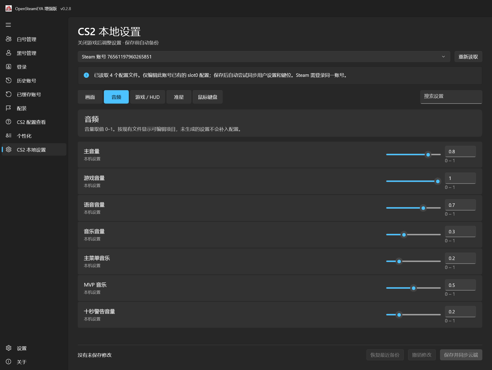

# OpenSteamEYA Enhanced

> **基于 WinUI 3 与 .NET 10 的 Windows x64 Steam 账号管理工具**
> 源自 [OpenSteamEYA](https://github.com/hvh-software/OpenSteamEYA)，专注独立账号管理与批量操作

[]()
[]()
[]()
[]()

---

## 📖 项目简介

**OpenSteamEYA Enhanced** 是一个面向 Windows x64 平台的 Steam 账号管理工具，使用 **C# / WinUI 3 / .NET 10** 构建，采用 **Native AOT 便携发布**方式，无需安装 .NET Runtime 即可运行。

本项目基于 [hvh-software/OpenSteamEYA](https://github.com/hvh-software/OpenSteamEYA) 扩展开发，在保留原有 EYA 登录、CS2 查询、配装、个性化等功能的基础上，**新增了独立的账号管理系统**，支持白号/黑号分类管理、批量导入导出、隐私模式、多分组等增强功能。

> **当前版本**：v0.2.8（CS2 本地设置编辑与自动云同步）

---

## ✨ 核心功能

### 🎛️ CS2 本地设置编辑

五类设置：画面、音频、游戏 / HUD、准星、鼠标键盘。无需打开游戏即可编辑现有 slot0 配置；保存前自动备份，保存后自动尝试同账号云同步。机器和画面文件仅本机保存。原多槽位只读页面保留为「CS2 配置查看」。详见 [使用说明](docs/CS2-LOCAL-SETTINGS.zh-CN.md)。



### 🎮 保留原有能力

完整保留 OpenSteamEYA 的全部核心功能：

- **Steam/EYA 登录**：支持 EYA 令牌登录 Steam 客户端
- **历史与缓存账号**：自动记录登录过的账号，带头像与昵称
- **CS2 查询**：优先分、等级、冷却/封禁状态查询
- **配装系统**：T/CT 整套武器预设，一键装备
- **个性化与云同步**：多语言界面、主题设置
- **创意工坊**：一键清理 CS2 创意工坊订阅

### 🆕 Enhanced 增强功能

#### 🎛️ CS2 本地设置读取

选择本机 Steam 账号，读取已保存的键位、视频、游戏、鼠标、准星及音频设置。支持按文件和分类筛选、搜索及刷新，显示来源路径和修改时间；本地配置与云缓存分别展示，仅读取、不改写配置。

#### 📇 账号卡片与列表管理

以卡片或紧凑列表形式展示账号，支持**搜索、收藏、多分组、备注**等操作。提供三种背景样式，默认分组包含全部账号，方便快速浏览与管理。

#### 📥 批量导入导出

支持按 `steam账号----steam密码` 格式**逐行批量添加**账号，同时支持 **TXT / CSV / JSON** 格式的导入导出，以及 **ZIP 格式的备份与恢复**。

#### 🔍 多选 CS2 批量查询

支持勾选多个账号后批量执行 CS2 状态查询：
- 查询**失败**的账号自动归入“失败”分类
- **无凭据**的账号归入“未查询”
- 查询**成功**后自动移除结果标记

#### 🚦 状态标记系统

冷却时间以**黄色**标记，**GCVAC** 标记以**红色**显示。仅显示实际存在的异常状态；无异常显示“正常”，无可靠数据显示“未知”。

#### ⚪⚫ 白号 / 黑号双轨管理

- **白号管理**：账密登录时勾选“同时添加到白号管理”，成功保存历史时同步账号和本次密码；默认勾选并记忆
- **黑号管理**：自动/手动及账号 Token 导入进入黑号管理
- **分类规则**：跨分类重复需人工选择唯一归属；旧管理记录留在白号管理，支持手动转移
- **注意**：单独添加账密不会生成 EYA 凭据

#### 🔒 隐私模式

提供圆点遮蔽显示和隐私模式切换，防止密码在界面中明文暴露。**但请注意**：账号管理密码以明文存储，导出和备份也包含明文密码，圆点和隐私模式不加密文件。

---

## 💻 下载与运行

### 系统要求

- **操作系统**：Windows 10 build 17763 及以上（x64）
- **运行时**：无需额外安装 .NET Runtime，Windows App SDK 运行文件随包附带

### 下载方式

从 [v0.2.8 Release](https://github.com/dbdbvdbdb/OpenSteamEYA-Enhanced/releases/tag/v0.2.8) 页面下载：

| 格式 | 大小 | 说明 |
|------|------|------|
| ZIP | 见 Release 附件 | 推荐，解压即用 |
| 7z | 见 Release 附件 | 压缩率更高 |

### 运行步骤

1. 下载 ZIP 或 7z 包（两者内容相同）
2. **完整解压**到本地文件夹，保留全部 DLL、PRI、Assets、Languages 和许可证文件
3. 运行 `SteamEyaWinUI.exe`
4. ⚠️ **不能只复制 EXE 文件**，必须保留完整目录结构

### 校验文件完整性

使用 PowerShell 计算 SHA256 校验和，与 Release 中的 `SHA256SUMS.txt` 比对：

```powershell
Get-FileHash .\OpenSteamEYA-Enhanced-0.2.8-win-x64-aot.zip -Algorithm SHA256
```

---

## ⚠️ 安全提示

> **请务必阅读以下安全说明**

- **明文密码存储**：账号管理密码以**明文**形式存储，导出和备份文件同样包含明文密码
- **文件访问限制**：请限制本机文件访问权限，**不要上传数据库、备份文件或含凭据的截图**
- **剪贴板安全**：复制密码后**不会自动清空剪贴板**，请自行注意
- **数据隔离**：Enhanced 管理库与原始 EYA 数据相互独立，ZIP 备份**不包含**原 EYA Token、Steam 会话和缓存凭据

---

## 📂 数据存储位置

| 数据类型 | 路径 |
|----------|------|
| Enhanced 管理库 | `%LocalAppData%\OpenSteamEYA-Enhanced\manager.json` |
| 本地背景 | `%LocalAppData%\OpenSteamEYA-Enhanced\backgrounds` |
| 可再生成缓存 | `%LocalAppData%\OpenSteamEYA-Enhanced\cache` |
| 原程序数据 | `%AppData%\SteamEYA` |
| 历史记录 | `%AppData%\SteamEYA\history\accounts.json` |

Enhanced 数据与原程序数据相互独立，互不影响。

---

## 🛠️ 源码编译

### 环境依赖

| 组件 | 版本要求 |
|------|----------|
| Windows | x64 |
| PowerShell | 7 |
| Git | 任意 |
| .NET SDK | **10.0.401**（由 `global.json` 精确锁定） |
| Visual Studio | 2022 / 2026 C++ Build Tools（MSVC x64/x86） |
| Windows SDK | **10.0.26100.0** |
| 7-Zip | 打包 7z 时需要 |

> `global.json` 固定 SDK 精确版本，避免预装 SDK 升级改变 Native AOT 依赖导致锁定还原失败。升级 SDK 时需同时审查并更新锁文件。

### 编译命令

```powershell
# 1. 确保原生工具链就绪
pwsh ./scripts/ensure-native-toolchain.ps1

# 2. 还原依赖（锁定模式）
dotnet restore ./SteamEyaWinUI/SteamEyaWinUI.csproj -r win-x64 `
    -p:Platform=x64 -p:PublishAot=true --locked-mode

# 3. 数据与 UI 检查
pwsh ./scripts/check-data.ps1
pwsh ./scripts/check-manager-ui.ps1 -NativeAot

# 4. 发布 Native AOT 便携包
pwsh ./scripts/publish-enhanced.ps1 -NativeAot -Version 0.2.8 -ReleaseLabel 0.2.8
```

NuGet 从官方源恢复，WinUI 使用允许随应用再分发的 **2.3.9** 组件包。

---

## 📚 文档索引

| 文档 | 说明 |
|------|------|
| [使用指南](https://github.com/dbdbvdbdb/OpenSteamEYA-Enhanced/blob/main/docs/RUNNING.zh-CN.md) | 详细使用说明 |
| [更新记录](https://github.com/dbdbvdbdb/OpenSteamEYA-Enhanced/blob/main/CHANGELOG.md) | 版本变更历史 |
| [格式与备份](https://github.com/dbdbvdbdb/OpenSteamEYA-Enhanced/blob/main/docs/FORMATS-AND-BACKUP.zh-CN.md) | 数据格式与备份规则 |
| [更新检查说明](https://github.com/dbdbvdbdb/OpenSteamEYA-Enhanced/blob/main/docs/UPDATES.zh-CN.md) | 自动更新机制 |
| [功能交付报告](https://github.com/dbdbvdbdb/OpenSteamEYA-Enhanced/blob/main/docs/FEATURES-0.2.5.zh-CN.md) | v0.2.5 改造详情 |
| [发布审查报告](https://github.com/dbdbvdbdb/OpenSteamEYA-Enhanced/blob/main/docs/RELEASE-AUDIT.zh-CN.md) | 开源审查记录 |
| [发布说明](https://github.com/dbdbvdbdb/OpenSteamEYA-Enhanced/blob/main/docs/releases/v0.2.8.md) | v0.2.8 发布说明 |

---

## 🖼️ 真实软件截图

以下为真实 WinUI 应用隔离测试截图，账号、密码与状态均为**虚构测试数据**，不代表真实 Steam 账号。截图不是 AI 效果图。


> 截图导出缩放不能代替各系统 DPI 的实机验收，详见[验收记录](https://github.com/dbdbvdbdb/OpenSteamEYA-Enhanced/blob/main/docs/FEATURES-0.2.5.zh-CN.md)。

---

## 🤝 贡献与反馈

- **Bug 反馈 / 功能建议**：请提交 [Issue](https://github.com/dbdbvdbdb/OpenSteamEYA-Enhanced/issues)
- **代码贡献**：请阅读 [CONTRIBUTING.md](https://github.com/dbdbvdbdb/OpenSteamEYA-Enhanced/blob/main/CONTRIBUTING.md)
- **安全报告**：请参阅 [SECURITY.md](https://github.com/dbdbvdbdb/OpenSteamEYA-Enhanced/blob/main/SECURITY.md)

---

## 📄 开源协议

本项目采用开源协议，第三方组件许可信息详见 [THIRD_PARTY_NOTICES.md](https://github.com/dbdbvdbdb/OpenSteamEYA-Enhanced/blob/main/THIRD_PARTY_NOTICES.md)。

---

## 🔗 相关项目

- [OpenSteamEYA](https://github.com/hvh-software/OpenSteamEYA) — 原始项目，开源 EYA 上号器
- [OpenSteamTool](https://github.com/OpenSteam001/OpenSteamTool) — Steam 客户端注入工具

---

<div align="center">

**OpenSteamEYA Enhanced** — 让 Steam 账号管理更高效

[⬆ 回到顶部](#opensteameya-enhanced)

</div>
