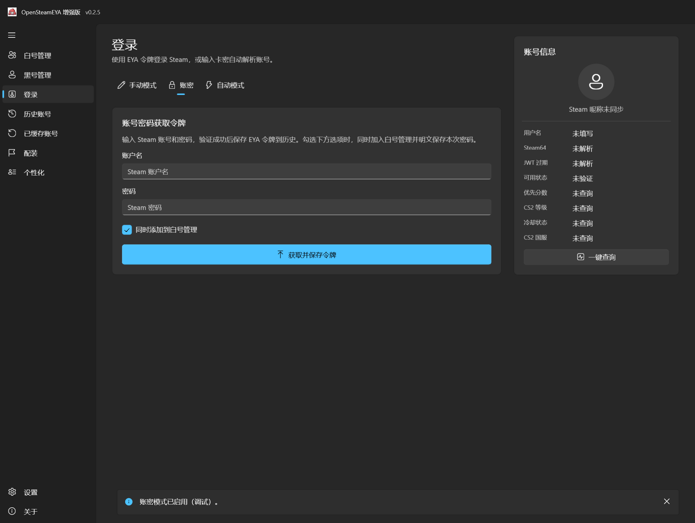
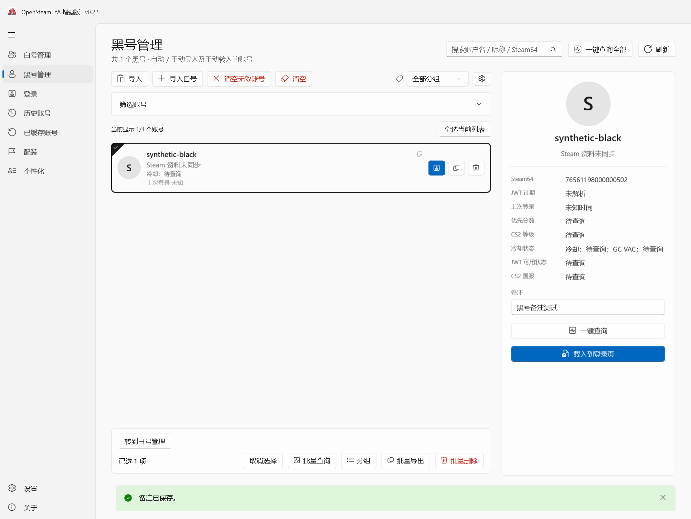

# v0.2.5 白号／黑号管理改造交付报告

交付日期：2026-10-15。基线：v0.2.4-beta 发布后的 b6f1e40 文档提交。本次版本：v0.2.5-beta 本地交付，未推送源码、创建标签或发布 GitHub Release。

## 已实现的规则

| 添加入口 | 管理归属与密码行为 |
| --- | --- |
| 登录 → 账密，勾选新增选项 | 原认证成功且历史保存成功后加入白号管理，并保存本次密码 |
| 登录 → 账密，未勾选 | 仅执行原登录／历史保存，不新建管理记录、不更新管理密码 |
| 登录 → 自动／手动 | 成功登录或成功查询并完成原历史保存后加入黑号管理 |
| 历史页账号／Token 导入 | 成功保存的账号加入黑号管理 |
| 历史页批量导入白号 | 逐个认证和保存成功后加入白号管理，保存对应输入密码 |
| 白号管理手动添加、批量添加、TXT／CSV／JSON 导入 | 保留原添加能力；跨分类冲突时先选择唯一归属 |
| 既有历史账号快速登录／载入登录页 | 不把既有账号当作新的手动来源重新分类 |

“同时添加到白号管理”默认勾选并记忆。账密成功后自动切到手动模式，仍保留本次账密来源；只有另行输入的账号／Token 或明确的自动来源才走黑号新增规则。认证失败、保存失败以及取消前尚未完成的账号不生成管理记录。分类写入失败会单独提示，不误报原 Steam 登录失败。

取消冲突窗口仅取消本次管理归属变更，不撤销已经成功完成的原认证／历史保存。批量操作中的已成功项保留，取消或失败项不新建另一类管理记录。

## 页面与操作

- 原账号管理导航、标题和设置入口统一更名为白号管理；卡片、列表、隐私、背景、密码复制显示、搜索、收藏、多组、批量导入导出、CS2 查询与备份入口保留。
- 黑号管理使用同一个真实 HistoryPage 的独立导航范围，复用搜索、状态筛选、多选、详情、查询、Token 导入导出和原登录服务；每次进入和刷新都只提供黑号集合。
- 白号卡片右键提供“转到黑号管理”；黑号勾选账号后提供“转到白号管理”。冲突窗口并列展示现有记录和本次记录，密码遮挡，说明选择不同归属时密码是否更新。
- 黑号的备注与分组使用管理库，转移往返不会丢失原白号的备注、分组、收藏、密码或背景。黑号和白号共用管理分组定义，删除分组不删除账号。历史页仍使用原历史分组／备注，不被批量覆盖。
- 没有 EYA Token 的转入账号显示未知状态；查询和 Token 导出要求补充凭据。有唯一关联的原 Steam 快速登录缓存时，一键登录仍调用原缓存恢复服务。

## 删除范围

所有管理、历史和缓存账号删除入口提供同一选择窗口：

- **删除应用内记录**（默认勾选）：删除对应白号／黑号管理记录和历史记录，包含管理密码、备注及历史 EYA Token。
- **删除 Steam 登录缓存**（默认不勾选）：调用原缓存删除接口，删除应用保存的对应快速登录缓存。

可以单独选择任意一项、同时选择两项或取消；全不选时禁用提交。不会删除 Steam 客户端的安装文件、游戏或客户端正在使用的配置文件。既有离线备份和导出不联动改写。若只有账号名且匹配到多个已知 SteamID，拒绝执行，先要求核对身份。

各原数据文件仍使用自己的保存接口；跨文件清理发生磁盘错误时会明确报告未全部完成，刷新后可重试剩余项，不宣称整组删除具有跨文件事务能力。

## 旧数据与备份兼容

- 旧管理记录不迁移、不猜测来源，默认保留在白号管理。
- 原 `manager.json` 的密码、账号结构和版本保持不变；两个管理页面共用原管理资料，归属保存在同目录独立 `account-categories.json` 中。该文件只保存分类身份和复选框偏好，不含密码或 Token。
- 新 ZIP 管理备份增加可选分类文件，并包含两类账号的管理资料和自定义背景；仍不包含原 EYA Token、Steam 会话和原快速登录缓存。
- 旧备份缺少分类文件时仍可恢复。覆盖恢复按备份分类（旧备份为白号）；合并恢复保留已有账号的归属，新增账号使用备份归属。
- 分组映射、背景资源校验、损坏文件拒绝覆盖及原 TXT／CSV／JSON 转义规则保留。

## 编译、验证与程序包

Windows x64 Native AOT 编译成功，编译日志无警告或错误。原生 PE 检查通过，不包含托管应用程序集或 .NET 运行时宿主，无需另装 .NET Runtime。

| 检查 | 结果 |
| --- | --- |
| 数据层 Native AOT 自动化检查 | 98 项通过，覆盖分类、去重、并发写入、旧／新备份及既有数据行为 |
| 实际 WinUI Native AOT 自动化检查 | 263 项通过，覆盖原卡片功能、来源规则、分类冲突、转移和删除范围 |
| 发布目录检查 | 300 个文件；必须的 WinUI／Steam 资源及许可证保留，无测试数据、调试产物 |
| ZIP、7z 校验 | 压缩完整性及包内逐文件 SHA-256 一致性检查通过 |
| 最终 ZIP 解压启动 | 原生窗口响应正常，正常退出；未执行真实登录或查询 |
| 敏感信息检查 | Git 历史和公开源码扫描未发现候选泄露；不等同于对未知敏感信息的绝对保证 |

全部自动化账号与密码为虚构测试数据，运行时数据在隔离目录；测试代码只编入显式 QA 构建，发布包排除这些测试代码与数据。[WinUI 检查明细](test-evidence/classification/ui-results.txt)和[交付校验记录](test-evidence/classification/verification.json)随源码保存。

| 文件 | 字节 | 大小 |
| --- | ---: | ---: |
| `OpenSteamEYA-Enhanced-0.2.5-beta-win-x64-aot.zip` | 29,614,302 | 28.24 MiB |
| `OpenSteamEYA-Enhanced-0.2.5-beta-win-x64-aot.7z` | 17,891,657 | 17.06 MiB |
| 解压目录（300 个文件） | 78,443,975 | 74.81 MiB |

程序包和 `SHA256SUMS.txt` 位于本地 `artifacts/` 目录，未上传 GitHub。ZIP 的 SHA-256 为 `32039b4f4ace53e7030a18fa73df286d4e92ce3b6e9eb217d2a06badbc431bad`；7z 的 SHA-256 为 `1b23709af32332e1c877e5b6ddadcd5985aa18b00b7fed30d009f8a726d636f3`。

本次代码没有新增 NuGet 依赖，没有替换原 Steam 登录、加密、EYA 认证或 CS2 查询算法。对原历史／缓存／设置服务的测试目录重定向仅存在于 QA 编译分支；生产版本沿用原目录。

## 真实运行截图

以下为真实 WinUI Native AOT QA 程序的运行界面截图，使用虚构账号；不是 AI 效果图。

页面截图通过 WinUI RenderTargetBitmap 导出。它不包含独立弹出层，因此不把底层页面截图当作冲突／删除窗口的视觉证据；这两个窗口的按钮、选择和取消行为已由上述实际 WinUI 自动化检查验证，弹出层外观仍需人工检查。

## 仍需人工验收

- 使用测试账号验证真实账密认证、Steam Guard、自动／手动登录，以及有实际缓存账号时的 Steam 启动恢复。
- 验证实际 CS2 联网查询、网络故障和服务端拒绝等情形；本次没有使用真实账号执行联网登录／查询，不能视为已通过。
- 实际系统 DPI 为 150%。已有 100%／125%／200% 渲染导出只检查像素尺寸，不替代各系统 DPI 的实机验收；其他 Windows 版本也需补测。
- 黑号列表与历史页复用布局；黑号备注和分组按管理库保存，历史页保留原存储。无原凭据的账号不能仅凭分类元数据完成登录或查询。
- 本次只交付本地程序包。GitHub Actions 配置已跟进新版本号，但未触发远端运行，不报告不存在的远端构建结果。

## 修改文件

- `.github/workflows/build.yml`
- `.github/workflows/release.yml`
- `.gitignore`
- `AccountManagement/AccountCategories.cs`
- `AccountManagement/BackupService.cs`
- `CHANGELOG.md`
- `README.md`
- `SteamEyaWinUI/Languages/en.json`
- `SteamEyaWinUI/Languages/zh-Hans.json`
- `SteamEyaWinUI/Languages/zh-Hant.json`
- `SteamEyaWinUI/MainWindow.xaml`
- `SteamEyaWinUI/MainWindow.xaml.cs`
- `SteamEyaWinUI/Pages/AccountCard.cs`
- `SteamEyaWinUI/Pages/AccountManagerBatchAdd.cs`
- `SteamEyaWinUI/Pages/AccountManagerDialogs.cs`
- `SteamEyaWinUI/Pages/AccountManagerPage.xaml`
- `SteamEyaWinUI/Pages/AccountManagerPage.xaml.cs`
- `SteamEyaWinUI/Pages/AccountManagerUiChecks.cs`
- `SteamEyaWinUI/Pages/CachedAccountsPage.xaml.cs`
- `SteamEyaWinUI/Pages/ClassificationPageChecks.cs`
- `SteamEyaWinUI/Pages/HistoryClassification.cs`
- `SteamEyaWinUI/Pages/HistoryPage.xaml`
- `SteamEyaWinUI/Pages/HistoryPage.xaml.cs`
- `SteamEyaWinUI/Pages/LoginPage.xaml`
- `SteamEyaWinUI/Pages/LoginPage.xaml.cs`
- `SteamEyaWinUI/Pages/SettingsPage.xaml`
- `SteamEyaWinUI/Services/AccountClassification.cs`
- `SteamEyaWinUI/Services/AccountHistoryService.cs`
- `SteamEyaWinUI/Services/ClassificationUiChecks.cs`
- `SteamEyaWinUI/Services/ManagerUiChecks.cs`
- `SteamEyaWinUI/Services/SettingsService.cs`
- `SteamEyaWinUI/Services/SteamLoginCacheService.cs`
- `SteamEyaWinUI/Services/SteamLoginService.cs`
- `SteamEyaWinUI/SteamEyaWinUI.csproj`
- `docs/FEATURES-0.2.5.zh-CN.md`
- `docs/FORMATS-AND-BACKUP.zh-CN.md`
- `docs/RUNNING.zh-CN.md`
- `docs/screenshots/0.2.5/classification-black-light.png`
- `docs/screenshots/0.2.5/classification-black.png`
- `docs/screenshots/0.2.5/classification-login.png`
- `docs/screenshots/0.2.5/classification-white.png`
- `docs/test-evidence/classification/ui-results.txt`
- `docs/test-evidence/classification/verification.json`
- `scripts/assert-portable-package.ps1`
- `scripts/check-manager-ui.ps1`
- `scripts/publish-enhanced.ps1`
- `tests/AccountManagement.Tests/CategoryChecks.cs`
- `tests/AccountManagement.Tests/Program.cs`
