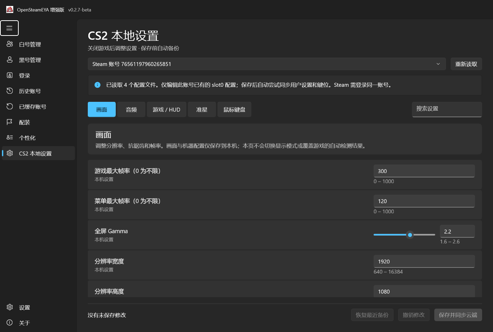
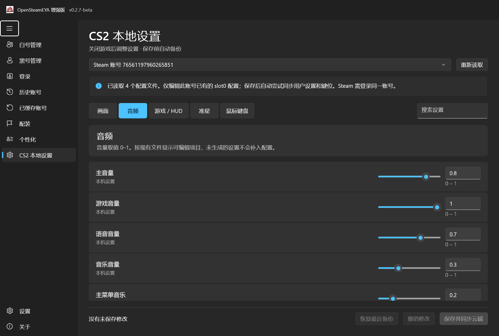
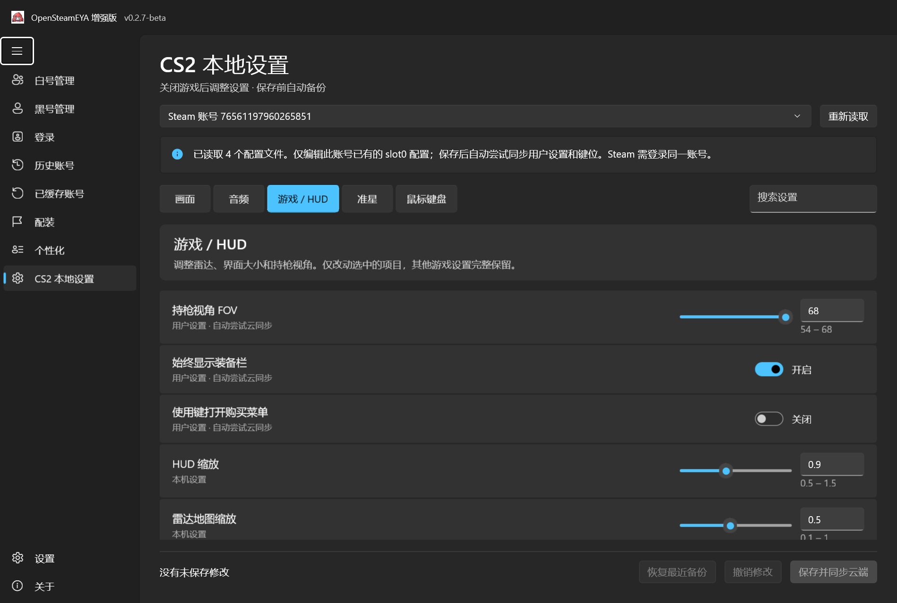
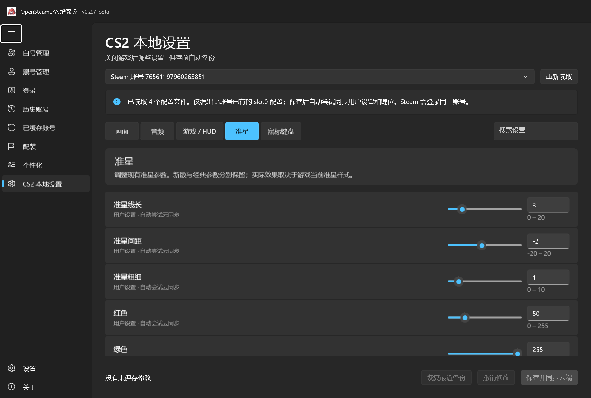
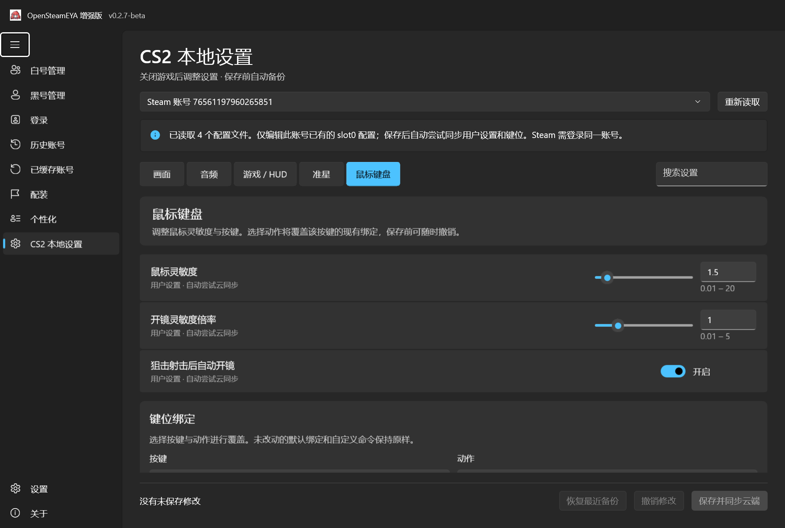
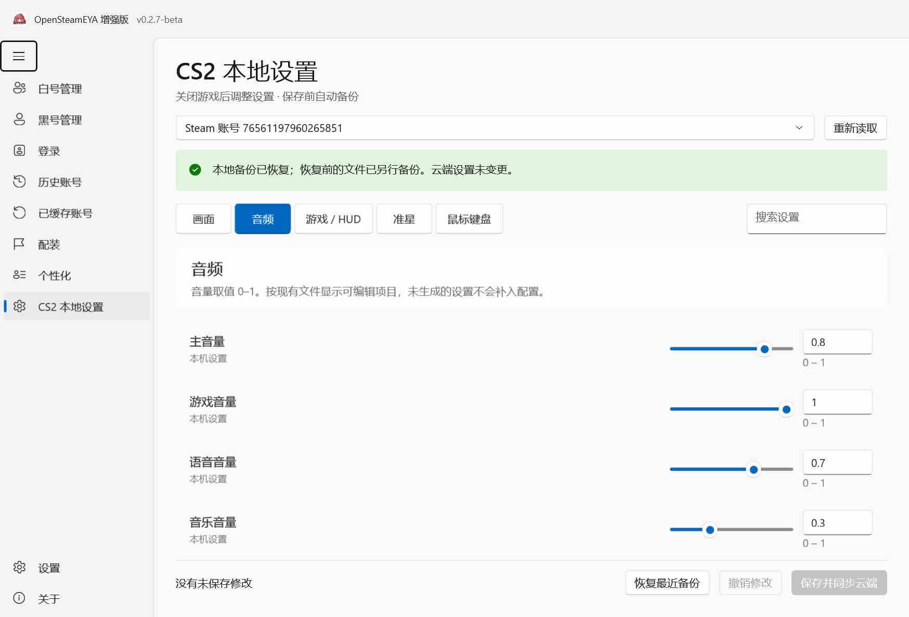

# v0.2.7-beta CS2 本地设置交付记录

日期：2026-10-16。基于本地 v0.2.6-beta 后续源码实施。本次完成本地代码、测试及便携包，未提交、推送 GitHub 或创建 Release。

## 已实现

新增独立「CS2 本地设置」导航，保留原「设置 → CS2 设置同步」。页面使用五类标签、成行设置、滑块、数值框、开关与下拉选项，支持搜索、账号切换、撤销编辑、保存前备份及恢复最近本地备份。快速输入后立即保存也使用最新输入，连续保存的最近备份按高精度时间排序。

从本机 Steam userdata 中发现已有 CS2 配置，按 AccountID / SteamID 匹配，不按昵称推断身份。只编辑已有 slot0 文件；未识别的参数与未改动的自定义键位保持原样。保存前检查参数范围、CS2 进程、只读、路径及外部变动，文件写入失败时尝试回滚。

保存后将本次用户设置及键位改动合入现有云镜像，调用原 Cs2CloudService，始终传入所选账号的 expectedSteamId64。机器与视频文件仅保存本地；缺少镜像、云关闭、账号不符、失败或部分失败明确提示。没有改动 Steam/EYA 登录凭据管理、账号密码格式、账号导入导出或原同步服务。

## 主要修改文件

- `SteamEyaWinUI/Pages/Cs2LocalSettingsPage.xaml`、`.xaml.cs`：真实可交互页面、编辑状态与云结果提示。
- `SteamEyaWinUI/Cs2Settings/ConfigText.cs`：保留原文的 KeyValues 解析与局部替换。
- `SteamEyaWinUI/Cs2Settings/SettingCatalog.cs`：支持字段、范围与键位动作。
- `SteamEyaWinUI/Cs2Settings/LocalConfigStore.cs`：账号发现、备份、冲突检查、写入回滚、恢复及云镜像合并。
- `SteamEyaWinUI/MainWindow.xaml`、`.xaml.cs`：导航与页面路由。
- `SteamEyaWinUI/Services/Cs2SettingsUiChecks.cs`、`ManagerUiChecks.cs`：隔离的真实 WinUI 测试。
- `tests/AccountManagement.Tests/Cs2ConfigChecks.cs`、`Program.cs`、`.csproj`：纯虚构配置回归。
- `SteamEyaWinUI/SteamEyaWinUI.csproj`、发布脚本、CI / Release 工作流：版本更新为 0.2.7，继续 Native AOT。
- `scripts/check-manager-ui.ps1`：新增 `-Cs2Only` 专项入口；默认仍执行全部 UI 测试。
- `scripts/assert-portable-package.ps1`：增加专项测试标记排除检查。
- README、CHANGELOG、使用说明、发布说明草稿、截图和验证记录；`.gitignore` 排除配置备份。

## 编译与测试

| 检查 | 结果 |
| --- | --- |
| 正式 Windows x64 Native AOT 编译 | 成功，最终发布日志无编译警告或错误 |
| Native AOT 数据测试 | 172 项通过，包括新增 38 项配置测试 |
| 最终 CS2 页面 Native AOT 专项测试 | 38 项通过，包括真实控件编辑保存、绑定、云目标账号、模拟云失败、恢复、搜索、账号切换、未知值、深浅主题与窄窗口 |
| 全量 WinUI 回归 | 在最后文案和未知值显示调整前，311 项通过；后续复跑在原有剪贴板测试遇到 `0x8004006A` / `0x800401D0`，未完成最新全量复跑，不能视为最终全量全部通过 |
| 最终正式包解压启动 | 响应正常、正常关闭；未执行登录或游戏配置写入 |
| Native AOT 产物校验 | x64 原生 PE，具有 AOT 标记，无托管应用 DLL / CoreCLR / runtimeconfig 等污染 |
| ZIP / 7z 完整性及内容 | 通过；301 个文件，保留 WinUI、Windows App SDK、Steam API 及许可证，无测试数据、截图、PDB 或临时文件 |
| GitHub Actions | 工作流配置已更新，本次未推送，因此没有新远程运行结果 |

证据见 [数据检查](validation/0.2.7/data-checks.txt)、[最终专项检查](validation/0.2.7/cs2-ui-checks.txt)、[先前全量检查](validation/0.2.7/full-ui-checks-before-final-polish.txt)、[正式包启动检查](validation/0.2.7/package-startup.txt)。测试期间没有写入真实 CS2 本地或云端配置。

复现命令：

```powershell
pwsh ./scripts/check-data.ps1
pwsh ./scripts/check-manager-ui.ps1 -NativeAot -Cs2Only
pwsh ./scripts/check-manager-ui.ps1 -NativeAot
pwsh ./scripts/publish-enhanced.ps1 -NativeAot -Version 0.2.7 -ReleaseLabel 0.2.7-beta
pwsh ./scripts/check-package-startup.ps1 -ZipPath ./artifacts/OpenSteamEYA-Enhanced-0.2.7-beta-win-x64-aot.zip
```

## 便携包

| 文件 | 字节 | MiB |
| --- | ---: | ---: |
| OpenSteamEYA-Enhanced-0.2.7-beta-win-x64-aot.zip | 29,783,712 | 28.40 |
| OpenSteamEYA-Enhanced-0.2.7-beta-win-x64-aot.7z | 18,021,413 | 17.19 |
| 解压目录，301 个文件 | 78,821,895 | 75.17 |

文件位于仓库 `artifacts/`，校验和同时保存在 [SHA256SUMS.txt](validation/0.2.7/SHA256SUMS.txt)。无需额外安装 .NET Runtime，必须完整解压，不能只复制 EXE。

## 真实截图

以下是最终 Native AOT WinUI 测试程序的 RenderTargetBitmap 截图，使用虚构配置与模拟云响应。不是 AI 效果图。截图捕获不含系统 Mica 背景，测试使用中性背景补齐；实际显示器缩放为 150%，不能视为其他系统 DPI 已实机通过。








## 限制与待验收

1. 本版覆盖五类常用参数，不等同于游戏设置菜单全部选项。显示模式、刷新率、部分高级画质不编辑；不为缺失字段生成假默认值。只支持已有 slot0，不改其他 slot。
2. 云推送复用原 Steamworks 服务；成功表示 SDK 返回写入成功，尚未验证真实服务器上传、其他设备下载及游戏内加载。Steam 需登录同一账号，缺少或损坏的云镜像不会被猜测重建。
3. 机器和画面文件只在本机生效；本地备份恢复不撤回云端。Steam 后续下载云配置仍可能覆盖本地，需在测试账号上确认往返结果。
4. 最新全量 UI 复跑受剪贴板占用 / 格式不可用影响；原复制逻辑未修改。发布前宜在剪贴板可用的 Windows 会话补跑默认完整检查。
5. 真实 Steam 登录、EYA、CS2 网络查询和修改设置后的游戏效果本次未实机验证。需人工按 [使用与验收步骤](CS2-LOCAL-SETTINGS.zh-CN.md) 验收；不得将模拟云测试算作真实云验收。
