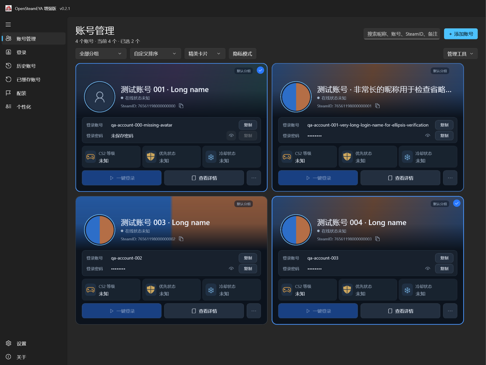
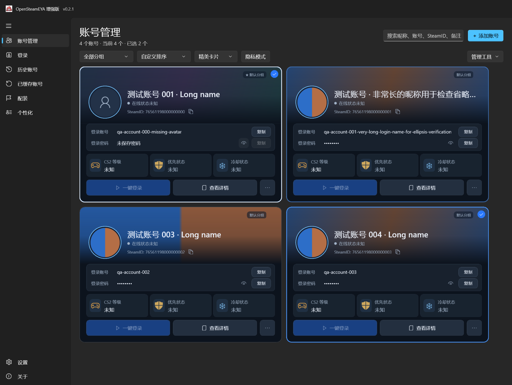

# OpenSteamEYA Enhanced 0.2.1 — 账号卡片 UI-R1 整改报告

以 0.2.0 为基线完成可交互的 WinUI 卡片重构，作为 0.2.1 UI 修订交付。参考图保存在 [ui-r1/reference.png](ui-r1/reference.png)。截图来自 Windows 上运行的真实 WinUI 应用，使用隔离的合成账号，未使用 AI 效果图。

## 修改文件

| 文件 | 修改内容 |
| --- | --- |
| `SteamEyaWinUI/Pages/AccountCard.cs` | 五区域原生卡片、统一圆角描边、选择标记、可访问操作按钮、紧凑模式、长文本及图片回退 |
| `SteamEyaWinUI/Pages/AccountManagerPage.xaml` | 原生项目容器模板、圆角键盘焦点、蓝色登录按钮样式、两行页面工具栏 |
| `SteamEyaWinUI/Pages/AccountManagerPage.xaml.cs` | 将列表选择同步到卡片描边；按可用宽度选择列数 |
| `SteamEyaWinUI/Pages/AccountManagerUiChecks.cs` | 实际控件事件、原生菜单/弹窗、状态叠加、布局和截图像素检查 |
| `SteamEyaWinUI/Services/ManagerUiChecks.cs` | 等待布局完成、按 DIP 调整窗口、截图倍率校验、保留剪贴板内容 |
| `SteamEyaWinUI/SteamEyaWinUI.csproj` | 版本号 0.2.1；保留原 Native AOT 配置 |
| `scripts/publish-enhanced.ps1`、`scripts/package-source.ps1`、`scripts/build-installer.ps1` | 默认版本号同步为 0.2.1 |
| `README.md`、`README-ENHANCED.zh-CN.md`、`docs/RUNNING.zh-CN.md`、`docs/DEVELOPMENT-LOG.zh-CN.md`、本报告及证据目录 | 交付说明、运行说明与验证证据 |

没有引入 UI 框架，没有新增查询服务。原账号数据模型、密码格式、存储、导入导出、备份以及 Steam/EYA 登录服务没有修改。44 个受保护业务源文件的 SHA256 与整改前一致，证据见 [business-integrity.json](test-evidence/ui-r1/business-integrity.json)。`AccountManagerPage` 中 `LoginAsync` / `QueryAsync` 也保持原内容。

## Hover 根因与修复

整改前 `AccountCard` 的 Border 圆角为 16，而 WinUI 2.2.1 默认 `GridViewItem` 模板的 `ListViewItemPresenter` 使用主题圆角 4。鼠标、选择和复选框是外层容器独立绘制，修改内层 Border 不会改变外层，因此出现接近直角的高亮角及重复选择框。

现在仍使用原生 `ListViewItemPresenter`，保留多选、键盘导航、焦点、拖拽和排序。容器与卡片外轮廓统一为 14 DIP，原生鼠标/选择覆盖层设为透明，关闭其独立勾选框；卡片自己用一个不可命中的圆角 Border 绘制描边。正常透明，Hover 透明度 0.6，选中透明度 1；选中且 Hover 保持 1。描边只做 140 ms 透明度过渡，不改变布局和位置。选中勾选标记为圆形。

键盘焦点仍由原生容器绘制，使用同一个 14 DIP 圆角及明暗两层高对比描边。实际截图中焦点为白色，与蓝色选择描边区分。卡片保留 `ThemeShadow` 和 Z 方向高度，没有在根部添加矩形裁切，不以裁切隐藏问题。取消批量替换卡片时的容器入场动画，避免 100 个账号筛选/换主题时逐项淡入造成空白截图或视觉闪动。

## 与参考图的布局对照

| 项目 | 参考图 | 实现 |
| --- | --- | --- |
| 外形 | 横向矩形、圆角、两列 | 常用宽度两列；很宽窗口三列或更多；不足时单列 |
| 顶部背景 | 宽幅背景，约占卡片高度四成 | 背景高按卡片宽度的 28% 计算，限制 120–190 DIP；向深色底部渐变 |
| 头像及昵称 | 圆头像、昵称/在线状态/SteamID 组合 | 92 DIP 头像；昵称 22；SteamID 后提供复制按钮；没有头像时显示原生占位图标 |
| 登录信息 | 独立半透明两行面板 | 76 DIP 面板；账号复制；密码圆点/未保存密码、眼睛按钮及复制；过长内容省略 |
| CS2 状态 | 三个等宽信息块 | 64 DIP 高；等级、优先状态、冷却状态；柔和图标和真实状态/未知 |
| 底部按钮 | 蓝色登录、详情、更多 | 44 DIP 高；两项等宽按钮和 42 DIP 更多按钮；登录禁用时蓝色降低透明度 |
| 圆角 | 柔和外角与内面板 | 外轮廓 14，内部面板 8，按钮 7；边框与覆盖层严格共用对应轮廓 |

按实际截图进行过两轮比例修正：扩大头像、登录信息区、状态块及按钮高度，减少背景顶部留白，把 SteamID 复制按钮移到文本附近。页面由三行工具栏改为两行，搜索/添加置于右上方，分组/排序/视图/隐私留在第二行；原导入、导出、备份、关联、分组、设置、刷新放入“管理工具”，事件仍调用原处理函数。

最终验收窗口 1440 × 1080 DIP 的实测卡片宽 564、高 378.67、背景高 157.92、底部按钮高 44、圆角 14。宽高比 1.49，参考图约 1.53；背景高度占比 41.7%，参考图约 42%。布局按窗口宽度自适应，而不是把参考图像素坐标硬编码到所有窗口。

背景继续调用现有异步服务，支持头像莫奈取色、公开 Steam 资料背景及自定义图片。没有将演示图上的照片、动漫头像或虚构状态写进真实账号。截图中的两色头像/图片是用于验证颜色提取和本地背景的合成测试素材。

## 构建及自动化结果

- Windows x64 / .NET SDK 10.0.401 / WinUI 2.2.1 / MSVC 14.44 / Windows SDK 10.0.26100.0。
- Native AOT UI 验收构建成功；原生 AMD64 PE，CLI 头为零，含 Native AOT 调试标记；没有普通自包含 .NET 回退。
- 183 项 UI/离线服务检查通过，记录 [ui-results.txt](test-evidence/ui-r1/ui-results.txt)，构建日志 [ui-aot-build.log](test-evidence/ui-r1/ui-aot-build.log)。
- 现有 Native AOT 数据回归程序重新运行：52 项通过，包括明文密码持久化、特殊字符导入导出、重复账号策略、备份恢复、非法备份拒绝、原子写入和并发更新，记录 [data-results.txt](test-evidence/ui-r1/data-results.txt)。本次没有修改该测试程序或其对应业务源文件。
- UI 验证了 10/50/100 账号的卡片及紧凑列表、隐私模式、深浅主题、最小及宽窗口、筛选/自定义排序及多选保持；原生按钮复制账号/密码/SteamID、原生显示隐藏按钮；两个菜单各保留 13 项；实际详情和背景弹窗打开/取消，原生收藏菜单写入隔离数据。
- 状态截图覆盖正常、Hover 处理函数、选中、选中且 Hover、原生键盘焦点；检查原生外层状态刷为透明且各层圆角一致。缺失背景、缺失头像、长昵称、长账号和未保存密码均有实际渲染证据。截图像素检查会拒绝只绘制页面却未绘制虚拟化卡片的结果。
- 原 JWT 检查、DPAPI 合成加密和 CS2 protobuf 编解码/截断检查通过；没有使用测试 Token 请求真实 Steam 登录。

## 实际运行截图

最终卡片，使用隔离的测试账号：



键盘焦点：



另见 [Hover](ui-r1/state-hover.png)、[选中且 Hover](ui-r1/state-selected-hover.png)、[浅色主题最小窗口](ui-r1/cards-100-light-minimum.png)、[浅色宽窗口](ui-r1/cards-100-light-wide.png)、[紧凑列表](ui-r1/list-100-dark.png)、[隐私模式](ui-r1/privacy-100.png)。全部状态与导出倍率截图保存在 `docs/ui-r1/`，整改前截图为 [before-0.2.0.png](ui-r1/before-0.2.0.png)。

这些图由运行中的 WinUI Native AOT 验收程序通过 `RenderTargetBitmap` 导出实际 XAML 视觉树，使用生产卡片、页面、菜单和服务。截图中的窗口背景使用中性主题底色，因为该 API 不包含 OS Mica；不是桌面全屏截图，也不用于证明系统合成阴影。该 API 的能力及限制见 [Microsoft RenderAsync 文档](https://learn.microsoft.com/en-us/windows/windows-app-sdk/api/winrt/microsoft.ui.xaml.media.imaging.rendertargetbitmap.renderasync?view=windows-app-sdk-2.0)。

## 已知差异与尚需实机验收

1. 照片/动漫背景和头像属于演示账号内容，并非提供了独立图片素材；真实账号使用自身头像与背景。未复制整张效果图当作控件，也未增加假等级/在线/优先资格数据。在线状态与优先状态在原快照没有可靠字段时显示未知；真实等级、冷却、优先分仍使用原快照和详情。
2. 全局导航、应用图标、标题栏和 Mica 沿用原程序，不在本次账号卡片整改中重做。浅色页面保留深色卡片与充分遮罩以保证背景上的文字对比度。
3. 当前显示器实际 DPI 是 150%。100%、125%、150%、200% **导出分辨率**已验证且校验像素尺寸，它们是同一实际布局的输出倍率，不等于四种系统 DPI 的实机测试。其他系统 DPI、跨屏及物理鼠标在各按钮间移动的完整 Hover 轨迹仍需人工验收。自动化 Hover 调用与生产指针事件共用的状态函数；键盘焦点使用真正的 `Focus(FocusState.Keyboard)`。
4. 真实 Steam/EYA 登录、缓存恢复、联网 CS2 查询、Steam 资料背景抓取需要用户授权账号与网络。按此前用户“稍后自行测试”的安排保留为未测试，没有要求发送密码或 Token。没有宣称这些联网操作已成功。
5. 系统 Mica、投影阴影、高对比模式、其他 Windows 10/11 主机仍需实际桌面观察。Native AOT 验收程序以编译开关隔离；正式运行包不含 QA 开关、测试目录、截图、PDB 或开发文档。

## 本地复验步骤

1. 解压完整 x64 包，运行 `SteamEyaWinUI.exe`，进入账号管理。保留所有 DLL/PRI/Assets/Languages 和许可证。
2. 显式关联自己的测试账号，测试账号/密码/SteamID 的复制，眼睛按钮，未保存密码显示以及原凭证一键登录。不要向聊天发送凭证。
3. 对未选卡片和已选卡片分别移动鼠标经过四角、头像、复制及底部按钮，移开后检查蓝色选择仍保留；用 Tab/方向键切换焦点，检查白色圆角焦点可见且不会触发登录。
4. 切换浅色/深色、最小/宽窗口、卡片/列表/隐私、分组和搜索；检查多选、收藏和所有右键入口。切换背景三种模式、清除本地背景、测试头像及背景缺失和长文本。
5. 分别在系统显示缩放 100%、125%、150%、200% 下启动应用；如有多屏再跨屏拖动，检查圆角、焦点、间距、阴影及文字。缩放变更是否需要注销按系统提示处理。
6. 使用测试数据进行批量导入/导出、备份/恢复，再检查原登录、EYA、CS2 查询、配装及个性化页面。数据回归程序覆盖数据处理，但不替代原生文件选择器及联网场景的人工验收。
7. 开发者可运行 `scripts/check-manager-ui.ps1 -NativeAot` 复现隔离验收及截图，使用 `scripts/publish-enhanced.ps1 -NativeAot -Version 0.2.1` 构建正式包。验收日志和截图在 `artifacts/ui-check-aot/ui-check-results/`；不会将合成账号写入真实账号文件，剪贴板原有格式在检查后恢复。

## 发布物

Windows x64 ZIP、7z、源码 ZIP 位于 `artifacts/`。最终体积、SHA256、编译警告统计、启动检查及实际几何值记录见 [release-verification.txt](test-evidence/ui-r1/release-verification.txt) 与 [release-size.json](test-evidence/ui-r1/release-size.json)。许可证、第三方声明和运行依赖全部保留；未引入安装器。

| 发布版本 | ZIP | 7z | 解压后 | 文件数 |
| --- | ---: | ---: | ---: | ---: |
| 0.2.0 普通自包含（优化前） | 68.27 MiB | — | 169.18 MiB | 520 |
| 0.2.0 Native AOT（整改前） | 27.00 MiB | 16.53 MiB | 70.05 MiB | 296 |
| **0.2.1 Native AOT UI-R1** | **27.03 MiB** | **16.55 MiB** | **70.14 MiB** | **296** |

正式包实际为 ZIP 28,343,629 字节、7z 17,351,398 字节，解压 73,551,314 字节。重构相对 0.2.0 AOT 仅增加 96,232 字节解压体积；没有为了 UI 引入大型依赖。ZIP 和 7z 均通过完整性检查。正式 ZIP 解压后的 EXE 已启动为可响应的原生窗口，文件版本 0.2.1.0，随后正常关闭本次启动的进程；0 个 PDB/QA/临时文件，EXE 内没有 QA 命令行开关。正式编译及最终 AOT 验收编译均为 0 警告、0 错误。

SHA256：

```text
ZIP  6ADB39A9B145F229581EF981886525AA0E520EEF4B946C1B6E3CC7803E6F04FE
7z   453A424FCB04EE0D9CF10CD3F1DA6830DBCCA73849AF1B72E3AE8DA23D9D5934
```
