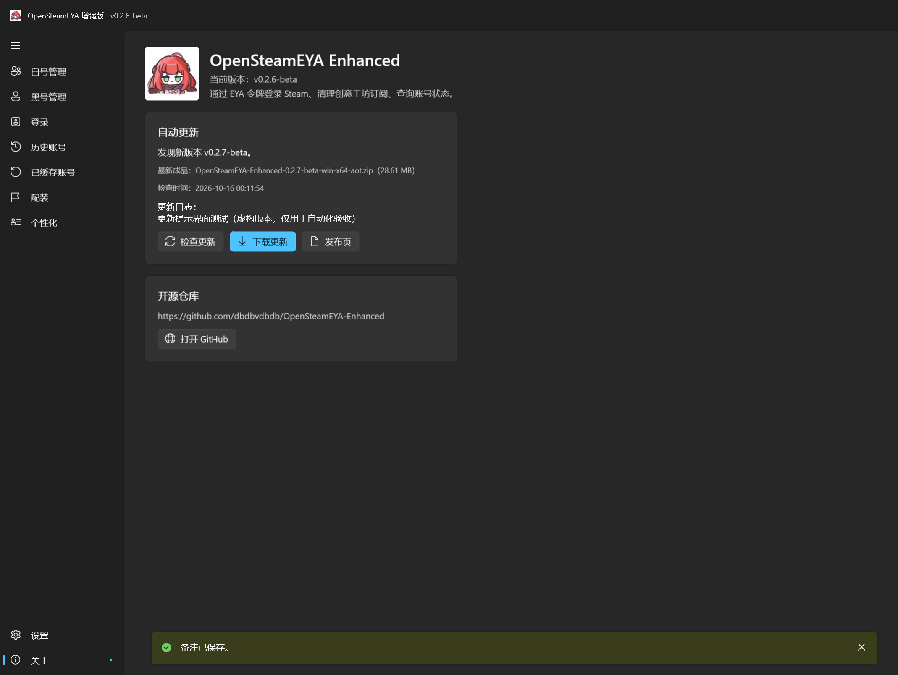
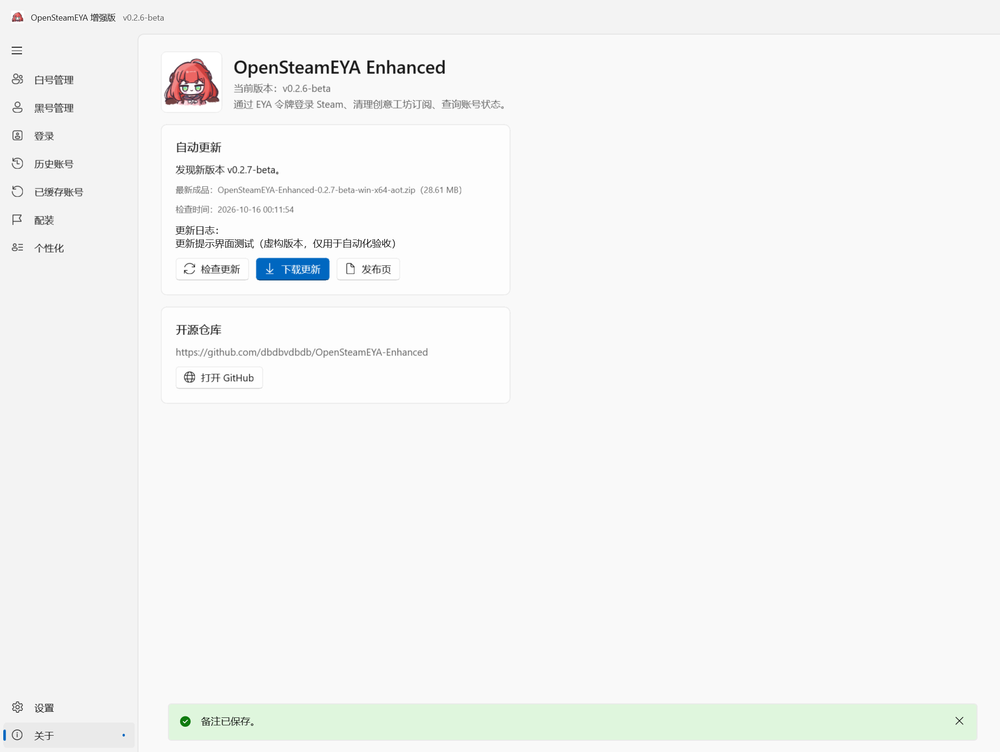

# 启动检查 GitHub 更新（v0.2.6）

每次打开程序，后台检查一次 [增强版 GitHub Releases](https://github.com/dbdbvdbdb/OpenSteamEYA-Enhanced/releases)。包括已公开的 beta 和正式版，不读取原 OpenSteamEYA 更新源，也不依赖另行上传 latest.json。

- 有新版时，“关于”导航出现更新标记；打开“关于”可查看版本、更新记录、ZIP 下载按钮及发布页链接。
- 按版本号比较而非发布日期排序。相同版本不会重复提示，不推荐降级；同号正式版高于 beta，beta.10 高于 beta.2，构建哈希不影响比较。
- 打开“关于”不会重复触发本次启动检查；需要重新检查时点击“检查更新”。
- 无网络、超时、GitHub 限流或响应异常时不打断启动、不弹窗、不后台循环重试；可在“关于”查看错误并手动重试。请求最长 20 秒。
- 仅检查并提供链接，不自动下载、安装、重启或覆盖程序。ZIP 和 7z 内容相同，在发布页任选一种完整解压。

版本信息通过官方公开接口 `https://api.github.com/repos/dbdbvdbdb/OpenSteamEYA-Enhanced/releases?per_page=100` 获取，读取最近最多 100 条发布记录，排除草稿及无效版本。请求不使用 GitHub 登录授权，不附带 Steam 账号、密码、EYA Token 或本地数据库；网络连接仍会向 GitHub 暴露通常的 IP 和 HTTP 请求头。

保留设置页中的下载代理选择，但代理只影响 ZIP 下载链接及下载站点延迟检测，版本查询始终直连官方 GitHub API。无有效 ZIP 时仍可打开官方发布页；不采用外部仓库或任意 EXE 下载地址。

当前版本的 beta 标识写入 InformationalVersion，发布脚本从 ReleaseLabel 生成它，使运行时与 Release 标签一致。GitHub API JSON 使用源生成，支持 Native AOT。

## 验证

自动化检查覆盖版本比较、beta 识别、草稿过滤、正确仓库和 ZIP、网络失败、空响应、取消、每次启动一次、手动重试及实际 WinUI 红点／按钮状态。测试使用虚构发布响应，不执行下载或安装。

另外使用同一更新服务的 Native AOT 实现匿名访问真实公开接口，成功识别现有 `v0.2.5-beta` 和对应 ZIP（29,614,302 字节）。后续本地构建高于线上版本时，不显示新版提示是预期行为。

API 行为参考 [GitHub 官方 Releases 文档](https://docs.github.com/en/rest/releases/releases#list-releases)。

## 实际界面

以下为真实 WinUI Native AOT 测试程序截图；v0.2.7-beta 为虚构测试响应，用于验证发现新版时的界面，不代表线上版本。

## 本次交付结果

2026-10-16 完成本地 v0.2.6-beta 构建验证，随后按用户授权发布到 [GitHub Release](https://github.com/dbdbvdbdb/OpenSteamEYA-Enhanced/releases/tag/v0.2.6-beta)。verification.json 记录发布前的验证时点。

- 134 项数据与更新逻辑检查、274 项实际 WinUI 检查通过。最终构建无编译警告或错误。
- 最终 ZIP 解压启动通过；确认原生 x64 PE，无托管运行时宿主，保留必须的运行依赖和许可证，未打入测试数据。
- ZIP：29,624,575 字节（28.25 MiB）；7z：17,902,521 字节（17.07 MiB）；解压 78,466,088 字节，300 个文件。
- 校验记录见 [verification.json](test-evidence/updates/verification.json)，界面检查明细见 [ui-results.txt](test-evidence/updates/ui-results.txt)。
- 本次改动集中于 GitHubUpdateService、AppState、MainWindow 启动入口、AboutPage、版本标签、说明文档及自动化检查。Steam 登录与账号数据服务未修改。
