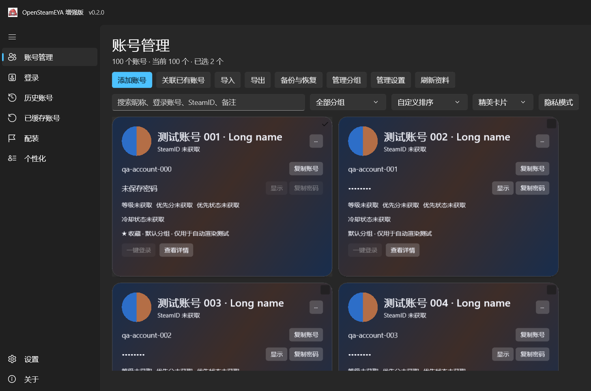
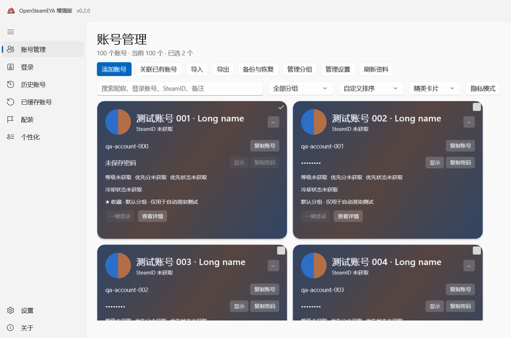
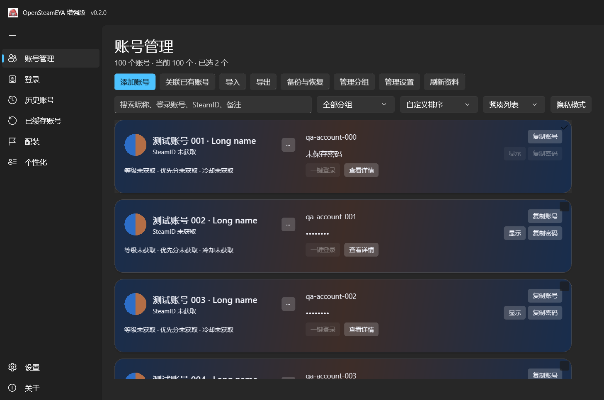
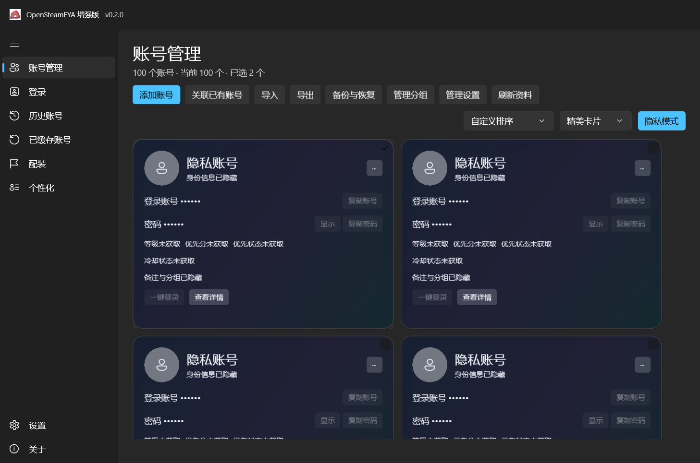

# 验证记录 — 0.2.0

本页记录首次普通自包含交付；后续 Native AOT 优化已经完成，C++ 工具链已经安装。新增 52 项 AOT 数据检查、111 项 AOT 界面/离线服务检查与体积对比见 [SIZE-OPTIMIZATION.zh-CN.md](SIZE-OPTIMIZATION.zh-CN.md)。下文“缺少工具链/未完成 AOT”是首次交付时的历史状态。

验证日期：2026-10-09。环境：当前 Windows x64 主机，.NET SDK 10.0.401 / 运行时 10.0.12，WinUI 包 2.2.1。测试均使用合成数据，没有登录真实 Steam 账号或访问真实密码。

## 自动检查

| 检查 | 结果 | 范围 |
|---|---|---|
| 数据层控制台检查 | 52 / 52 通过 | 格式往返、特殊字符、重复策略、身份映射、并发存储、分组、备份及失败恢复 |
| WinUI 原生合成界面检查 | 101 / 101 通过 | 10、50、100 账号，卡片/列表，浅色/深色，隐私，筛选/多选/排序，密码显示/隐藏及剪贴板 |
| 背景检查 | 包含于上述 101 项 | 多色取色、缓存、缺失图片/头像回退、本地图片异步柔化 |
| 发布 | 普通 .NET 自包含 Windows x64 | 正式包关闭 QA 编译开关，包含运行时、WinUI 依赖、资源、说明及许可 |

读取正式 DLL 的 PE/CLI 元数据，确认存在 AccountManagerPage，且不存在测试专用 ManagerUiChecks 类型。

数据层包含：TXT v1/v2、CSV、JSON 的密码精确往返；100 条批量记录；空密码和元数据；JSON 非法字段、CSV 重复表头及行号错误；跳过/填空/覆盖；SteamID、账号名、手动映射及冲突、不使用昵称；分组删除/选择范围；多存储实例并发；ZIP 全字段及图片恢复、合并、版本/路径/重复校验、资源提交失败回滚、损坏文件保护及有效备份恢复。

界面检查通过真正的 WinUI 窗口、控件和 RenderTargetBitmap 执行；同时检查集合/选中状态和可见文本。不是对每个按钮和对话框的完整鼠标操作测试。剪贴板只复制合成账号与含特殊字符的合成密码，随后恢复原有全部可获取格式。没有为真实密码创建日志。

实际 XamlRoot.RasterizationScale 为 1.25，即 125%。检查了 1180×780、1280×860、1680×980 窗口；没有声称完成 100%、150%、200% DPI 或所有 Windows 版本验证。RenderTargetBitmap 不包含 OS 的 Mica 背景，截图使用测试专用中性色背景。

测试证据：`test-evidence/ui-results.txt`、`data-results.txt` 及截图。界面成功运行目录为 run-20261009-164733-20dd98。

## 界面证据

## 原功能与剩余实机验收

原登录服务、认证/加密、Token、Steam 配置写入及 CS2 协议业务代码没有修改。增强页调用原 LoginPage 登录/查询路径；这只能证明接入和代码边界，不能替代真实 Steam 环境回归。

尚未实测的项目及原因：

- EYA 登录、缓存登录、Steam 切换、CS2 查询，以及原配装、工坊、个性化页面实际联网操作：没有用户授权的真实测试账号。
- 公开 Steam 资料背景成功获取、私密/动态背景兼容：取决于当前页面结构、网络和图片格式；实现有失败回退，本次未将成功联网计为通过。
- 原快照没有可靠优先账户字段，显示“优先状态未获取”；没有可靠在线状态接口，因此不猜测在线/离线。
- 多台 Windows 10/11、100%/150%/200% DPI、长时间大量账号操作、所有导入/备份文件选择器与右键菜单的人工操作：需实际使用验收。
- Native AOT：本机 C++ 链接工具链缺失，AOT 发布失败后交付普通自包含版；未声称 AOT 已通过。
- Inno Setup 安装/卸载、GitHub CI 发布及自己的远程更新：未执行，尚未提供独立远程仓库。

验收建议：先使用测试账号，在独立目录验证 EYA/缓存登录及 CS2 查询；确认原账号凭证未被导入/备份恢复改写。随后对真实使用的 DPI、卡片右键、文件选择器及跨机备份做人工验收。所有明文数据与备份由使用者自行保管。
