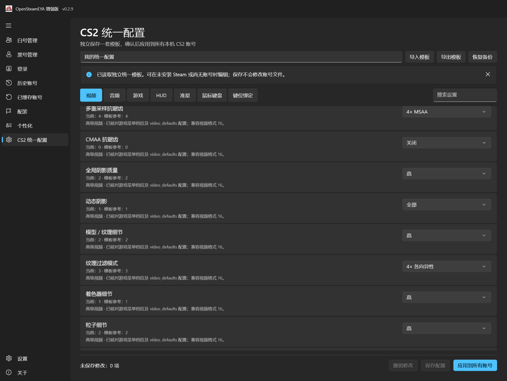
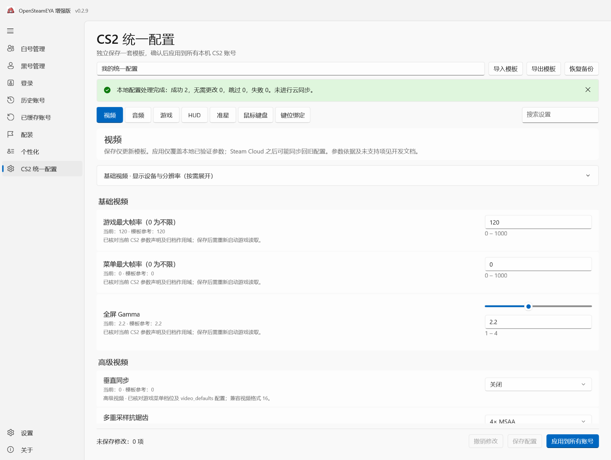

# 移除旧 CS2 配置查看页面：实施与验证

执行日期：2026-10-19。基线：`main` 提交 `23ca4355758745a5de6856f072246fdee37900b5`，已发布程序 v0.2.9。功能分支：`codex/remove-cs2-config-viewer`。本次是未发布开发变更，不指定新的正式版本号。

## 实施范围

- 删除旧只读页面 `Cs2SettingsPage`、其导航项、路由及语言刷新引用。
- 删除只为该页面使用的 `Cs2SettingRow`、`Cs2LocalSettingsService`、`Cs2SettingsParser`；其余生产代码无调用者，统一配置使用独立的 `ConfigText` 与 `LocalConfigStore` 等组件。
- 删除旧页面的 UI 检查、专用数据检查及项目链接，清理三种语言中各 71 条旧页面文本。
- 保留统一配置的全部实现；添加语言切换后的导航回归检查。更新当前指南与“未发布”更新记录，保留历史版本事实和截图。

未改动账号存储、登录和凭据流程、CS2 查询服务、`Cs2Settings` 目录中的模板/读写/应用实现、设置页面和独立同步服务。没有配置迁移步骤，不删除任何用户文件，也不改变同步规则。旧页面专有的多槽位/云缓存只读浏览随页面移除，不提供新的替代查看页。

## 已执行检查

环境：Windows x64、.NET SDK 10.0.401、已安装 C++ 工具链与 Windows SDK，Native AOT 发布。

| 检查 | 实际结果 |
| --- | --- |
| `scripts/check-data.ps1` | 238 项隔离数据检查通过；旧查看器专用测试已随组件退役，不算作通过项目 |
| `scripts/check-manager-ui.ps1 -NativeAot` | 319 项真实 WinUI 检查通过 |
| 简体中文、英文、繁体中文切换 | 每种语言均确认旧查看入口不存在、统一配置入口唯一且保留；不保存测试语言偏好 |
| 统一配置数据回归 | 模板导入/保存/恢复、账号预览/应用/备份/恢复、冲突与回滚保护等检查通过 |
| 统一配置界面回归 | 各类别、草稿、保存、预览取消、两个合成账号应用、独立备份、搜索、缺失参数、窄窗口等检查通过 |
| 账号与原服务离线回归 | 卡片、列表、分类、分组、密码复制、导入导出、备份及原协议合成输入检查通过 |
| 敏感信息检查 | Gitleaks 全引用历史和待公开源码扫描通过，未报告泄漏 |

数据日志：[238 项检查](test-evidence/viewer-removal/data-results.txt)。UI 日志：[319 项检查](test-evidence/viewer-removal/ui-results.txt)。

## 真实应用截图

本机真实 Native AOT WinUI QA 批次 `run-20261019-224316-259a21`，输出由项目已有的 `RenderTargetBitmap` 检查流程生成，没有 AI 绘图或界面拼接。仅使用隔离模板与虚构账号目录，没有使用 Steam 会话、凭据或 Cloud API。实际系统栅格缩放为 1.5；这不代表已覆盖全部系统 DPI。

未指定新版本号，QA 标题沿用基线 v0.2.9。下图只表示本次未发布开发变更，不替换首页已发布版本截图。

原图均为 PNG，2138 × 1608：

- 深色 SHA-256：`2A6414CFF9C77B86740B384A6617DD338D429079EE17EE45B3FDA46514AD32A9`。
- 浅色 SHA-256：`116F81030CE75DC0D9D83E71EA132FFC11737E0E2DFA40F2A8602E77E0ADC5DB`。

## Windows x64 本地预览包

已执行 `scripts/publish-enhanced.ps1 -NativeAot -Version 0.2.9 -ReleaseLabel 0.2.9-viewer-removal-preview`。这是独立命名的开发预览包，不是 v0.2.9 正式 Release 的替换，也不是新版本发布。

生产包通过原生 x64 PE / Native AOT 校验、运行文件与许可证检查、ZIP/7z 完整性检查，未回退到普通 .NET 自包含发布。生产包不含 QA 入口、测试数据库或调试符号；无需额外安装 .NET Runtime。

| 文件/目录 | 大小（字节） |
| --- | ---: |
| `OpenSteamEYA-Enhanced-0.2.9-viewer-removal-preview-win-x64-aot.zip` | 29,954,173 |
| `OpenSteamEYA-Enhanced-0.2.9-viewer-removal-preview-win-x64-aot.7z` | 18,135,601 |
| 解压目录（302 个文件） | 79,212,090 |

文件在本机工作区的 `artifacts` 目录。指标：[package-size.json](test-evidence/viewer-removal/package-size.json)；校验值：[SHA256SUMS.txt](test-evidence/viewer-removal/SHA256SUMS.txt)。本轮实际运行的是 Native AOT QA 构建；生产包执行结构与打包检查，未启动生产程序访问当前用户数据目录。

## 限制与后续

- 未在本轮执行真实 Steam 登录、联网 CS2 查询、Cloud 推送或游戏效果测试，不能将离线回归视为这些功能实测。独立同步入口和实现未改动。
- 生产编译仍有既有 `CS0649` 警告：统一配置的 `_steamOverride` 仅在 QA 构建赋值，生产构建保持 null；本次不调整该实现。
- 变更经独立 PR 审核；不自行合并或创建 Release。正式版本号与发布日期另行决定。
